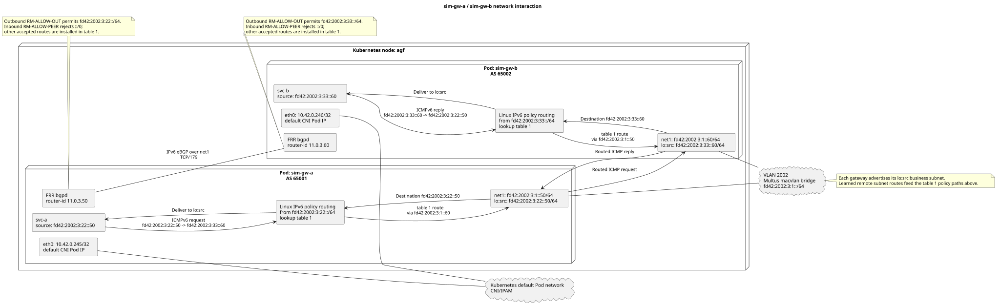

# BGP Gateway Simulation Example

End-to-end BGP gateway simulation demonstrating the FRR sidecar pattern with Multus networking and BGP route exchange between two simulated gateways.

## Overview

Two gateway pods (`sim-gw-a` and `sim-gw-b`) run on the same node, connected via a macvlan bridge-mode secondary network (VLAN 2002 on `enp4s0`). Each pod runs:

- **init-net** (`svc:v1.0.0-beta.1`) — init container that creates `net1` (data plane) and `lo:src` (business loopback) interfaces.
- **svc** (`svc:v1.0.0-beta.1`) — workload container that pings the peer's `lo:src` address every 10 seconds.
- **bgp** (`bgp:v1.0.0-beta.1`) — FRR sidecar that establishes BGP peering and advertises routes.

## Network diagram



## Files

| File | Description |
|------|-------------|
| `Dockerfile.svc` | Alpine-based svc/init-net container image (`svc:v1.0.0-beta.1`) |
| `Makefile` | Build svc image, deploy/undeploy sim-gw resources |
| `network.yaml` | `NodeNetworkConfigurationPolicy` (VLAN device) + Multus `NetworkAttachmentDefinition` (`macvlan-enp4s0-2002`) |
| `sim-gw-a.yaml` | Deployment `sim-gw-a` + ConfigMap `sim-gw-a-config` (AS 65001) |
| `sim-gw-b.yaml` | Deployment `sim-gw-b` + ConfigMap `sim-gw-b-config` (AS 65002) |
| `sim-gw-network.puml` | PlantUML source for the network diagram |
| `sim-gw-network.svg` | Rendered network diagram embedded above |

## Requirements

- Multus CNI installed with a default pod network.
- nmstate operator installed (for `NodeNetworkConfigurationPolicy`).
- Node `agf` with physical interface `enp4s0` available for VLAN 2002.
- Both pods use `nodeSelector: {kubernetes.io/hostname: agf}` because macvlan bridge mode is L2-local.

## Addressing

| Pod | net1 (data plane) | lo:src (business) | AS |
|-----|-------------------|--------------------|------|
| sim-gw-a | `fd42:2002:3:1::50/64` | `fd42:2002:3:22::50/64` | 65001 |
| sim-gw-b | `fd42:2002:3:1::60/64` | `fd42:2002:3:33::60/64` | 65002 |

The pods peer over IPv6 on `fd42:2002:3:1::/64`. sim-gw-a advertises
`fd42:2002:3:22::/64` over BGP; sim-gw-b advertises `fd42:2002:3:33::/64`.
BGP router IDs remain IPv4 values, as required by the BGP protocol.

## Build

Build the svc image and import it into the cluster's containerd runtime:

```sh
make -C examples/k8s build-svc
```

The BGP sidecar image (`bgp:v1.0.0-beta.1`) is built separately via the root `Makefile`:

```sh
make build-img
```

## Deploy

```sh
make -C examples/k8s deploy NAMESPACE=<namespace>
```

Or apply manually in order:

```sh
kubectl apply -n <namespace> -f examples/k8s/network.yaml
kubectl apply -n <namespace> -f examples/k8s/sim-gw-a.yaml
kubectl apply -n <namespace> -f examples/k8s/sim-gw-b.yaml
```

## Undeploy

```sh
make -C examples/k8s undeploy NAMESPACE=<namespace>
```

## Verify

After BGP establishes (check `kubectl logs deploy/sim-gw-a -c bgp`), the svc container logs show ping results:

```sh
kubectl logs -n <namespace> deploy/sim-gw-a -c svc
kubectl logs -n <namespace> deploy/sim-gw-b -c svc
```

Manual verification:

```sh
kubectl exec deploy/sim-gw-a -c svc -- ping -6 -I fd42:2002:3:22::50 fd42:2002:3:33::60
kubectl exec deploy/sim-gw-b -c svc -- ping -6 -I fd42:2002:3:33::60 fd42:2002:3:22::50
```

## Makefile targets

| Target | Description |
|--------|-------------|
| `build-svc` | Build `svc:v1.0.0-beta.1` from `Dockerfile.svc`, save as tar, import into containerd |
| `deploy` | Apply `network.yaml`, `sim-gw-a.yaml`, `sim-gw-b.yaml` |
| `undeploy` | Delete all sim-gw resources |
| `rmi-svc-tag` | Remove the `svc:v1.0.0-beta.1` image from Docker |
| `show-routes` | Show BGP routes currently received on `sim-gw-a` and `sim-gw-b` |
| `show-logs` | Show the latest 100 log lines per container for both gateways |
